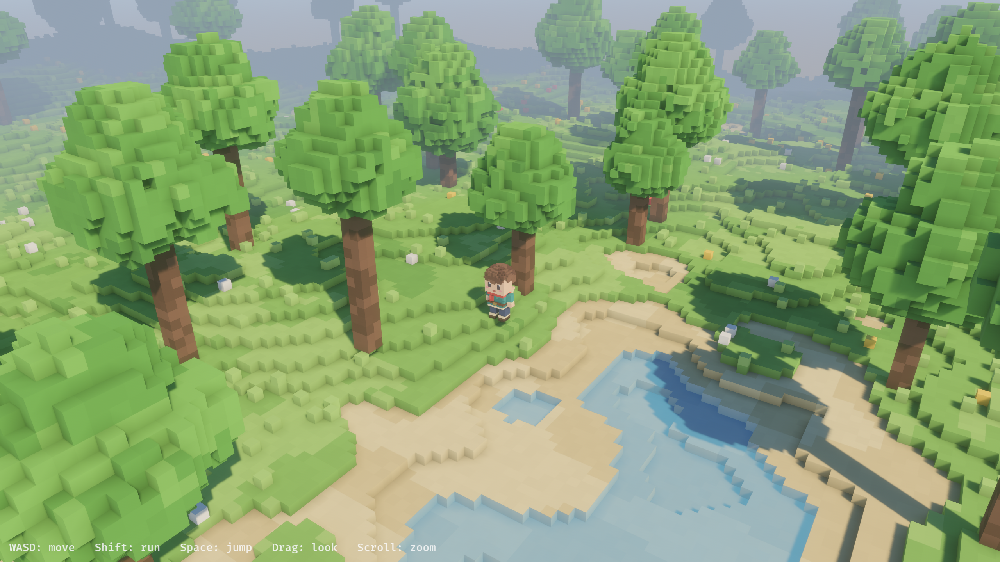

# Cubelark

A small HD voxel game on Bevy 0.20 ECS: an endless, streamed voxel world and a chibi voxel
hero you walk around in third person. Voxels are small (25 cm terrain, 5 cm characters) and
lit like a modern diorama render: baked per-vertex AO, per-voxel color jitter, PBR surfaces,
soft cascaded shadows, SSAO, TAA, bloom, distance fog, and a physical sky.



```sh
bevy run            # or: cargo run
bevy run web --open # in the browser (WebGPU)
```

Controls: `WASD`/arrows move, `Shift` runs, `Space` jumps, drag to look, scroll to zoom.

## Reshaping the land (desktop)

Cubelark is AI-native: you don't stack 25 cm voxels by hand, you say what the land should
become. Press `G`, drag across the ground to select an area (a click selects a 6 m square, up
to 48 m a side), then press `T` and describe it: "a pond with sandy banks", "a winding stone
path to the hill", "terraced hillside with a few trees".

The agent never returns voxels. It answers with a few terrain operations in the area's frame
(meters from its corner, levels relative to sea level): `raise`, `lower`, `flatten`, `smooth`,
`terrace`, `water`, `paint`, `scatter` (trees, bushes, rocks, flowers, grass), `path`, and
`clear`, each with an optional rectangle or ellipse and a soft edge. `src/world/sculpt.rs`
checks them against limits and turns them into voxels the same way every time.

The result is a live preview in the world: `Enter` keeps it, `Esc` puts the ground back
exactly, and further messages revise it. Kept changes join the undo history with builds and
go into the world's change log as operations, never voxels (see below). The area stays
selected for follow-ups; `Esc` clears it. Agents also get a `sample_terrain` tool for a finer
height map of part of the area.

Script one: `CUBELARK_AREA=14 CUBELARK_PROMPT="a small pond" cargo run` selects a 14 m square
in front of the hero and sends the message (add `CUBELARK_KEEP=1` to keep the preview).

There's no hand editing of single voxels: land only changes through these described edits.
The edits are a sparse layer on top of the world seed (`src/world/mod.rs`): chunks apply them
whenever they generate, and changed chunks (plus neighbors sharing the border) remesh in the
background. Agents' `get_build_site` sees the reshaped terrain too.

## The world as a log, and who may change what

The world is the seed plus an ordered log of changes (`saves/world.json`): builds placed,
moved, revised and removed, terrain changes, and parcel claims. Each change records who made
it (your player in `saves/profile.json`, editable in the panel), which agent did if one did,
the request, and when. A selected build shows "made by you with Claude Code, 2 h ago".

- **Replay is the truth.** Loading replays the log; terrain changes compile against the ground
  the earlier changes left, so the same log always gives the same voxels.
  `saves/world_edits.json` is only a cache of that, used while its hash matches the log.
- **Undo never deletes history:** it appends a revert. Rollback (one player, a time range) is
  replaying without those changes (`WorldLog::without`).
- **Parcels:** land is split into 8 × 8 m parcels. A change must be allowed on every parcel it
  touches, and claims the unclaimed ones for its author. Others' parcels and the spawn (24 m
  around the start) are off limits; terrain edits reaching into a neighbor's parcel are cut off
  there. The world's first player is its admin and isn't bound by any of this. `P` outlines the
  parcels around you; a selected area shows who owns it, with **Claim** and **Release**.
- **Budgets:** per parcel 12 builds, 40k visible build faces, 150k build voxels and 4k glowing
  voxels; per player 60 builds, 1.5M build voxels and 2M voxels of terrain changes. The panel
  shows what's left; anything over is refused with which budget it breaks.
- Ownership and budgets aren't saved anywhere: they're derived from the log, and replay
  enforces them as of each change, so a log can't hold anything its authors weren't allowed
  to do.
- Saves from before the log are migrated once (old files kept as `.bak`).
- Try it from someone else's side: `CUBELARK_AS=Bo cargo run` plays as a non-admin guest for one
  run; `CUBELARK_PARCELS=1` starts with the parcel overlay on.

Web builds use WebGPU, which the physical sky needs, so they need a WebGPU browser (recent
Chrome, Edge, Safari or Firefox). On the web, SSAO and model hot reload are off, and chunks
generate on a single thread, so the world fills in more slowly; `bevy run --release web`
helps a lot.

## Builder chat (desktop)

Press `Tab` for the builder panel, pick **Claude Code** or **Codex CLI**, and describe
something to build. The agent answers with a small JSON build spec; the game validates it,
turns it into voxels, and shows it in front of you as a draft. Placed builds are solid (you
can bump into and stand on them) and recorded in the world's change log.

- Drafts stick to the surface under your cursor, Minecraft-style: on top of what you point
  at, or against its side. Click to place, right-click or `Esc` to cancel, `Q`/`E` to turn,
  `R`/`F` to raise and lower. A red outline means it can't go there: it would overlap you, or
  the land or its budget doesn't allow it (the panel says which).
- Click a placed build to select it (cyan outline); a build you just placed stays selected.
  While one is selected, chat messages revise *that* build in place (Place keeps the
  change, Cancel edit restores it). A hint bar at the bottom shows the shortcuts that apply:

  | Context | Shortcuts |
  | --- | --- |
  | Anywhere | `T`/`Enter` talk to the agent · `G` select ground to reshape · `P` show parcels · click a build to select · middle-click to copy it · `Ctrl/Cmd+Z` undo |
  | Selecting ground | drag across the ground · right-drag look · `G`/`Esc` stop |
  | Area selected | `T` describe the change · `G` select again · `Esc` clear |
  | Land preview | `Enter` keep · `T` ask for changes · `Esc` put the ground back |
  | Selected build | `M` or double-click move · `Delete`/`Backspace` delete · `T` change it · `Esc`/right-click deselect |
  | Draft following the cursor | click place · `Q`/`E` turn · `R`/`F` raise/lower · `Esc`/right-click cancel |
  | Pinned revision | `Enter` keep · `M` pick it up · `T` ask for more · `Esc` cancel |

  Undo steps back through placing, deleting, moving, and revising builds, and kept land changes.

- Needs `claude` and/or `codex` on your `PATH`, already logged in.
- The agents get no other tools: no shell, no file edits, no other MCP servers, and no user config
  (`--tools ""` / `--sandbox read-only --ignore-user-config`). They run in an empty temp
  directory and can only return JSON matching `crates/rules/src/build_spec.schema.json`.
- Agents can look at the world through read-only tools the game serves over MCP
  (`src/agent/mcp.rs`, `src/agent/tools.rs`): `get_build_site` (ground heights and surfaces
  under the footprint), `list_nearby_builds`, `get_build_spec`, and `check_build` (limits plus
  floating/buried/overlap report). The server listens on `127.0.0.1` on a random port with a
  per-run bearer token, and the CLIs get only this server (Codex auto-approves just its tools).
- Every build passes the same limits a server would enforce (`crates/rules/src/build.rs`):
  size ≤ 64³ voxels at 12.5 cm, ≤ 200 shapes, ≤ 24 colors, ≤ 120k voxels, ≤ 60k visible
  faces, ≤ 3k glowing voxels. A rejected build is sent back to the agent once for a fix.
- Script a build: `CUBELARK_PROMPT="a red mailbox" CUBELARK_AGENT=codex cargo run`
  (add `CUBELARK_SELECT_LAST=1` to revise the most recent build instead).

## How it fits together

| Piece | Where | Role |
| --- | --- | --- |
| World rules | `crates/rules/` (`cubelark_rules`) | Everything that decides what the world is, with no rendering, so a server can share it: voxel models, the terrain generator (`terrain.rs`), terrain changes (`sculpt.rs`), build specs (`build.rs`), the change log and replay (`log.rs`), parcels (`land.rs`), budgets (`budget.rs`) |
| World streaming | `src/world/mod.rs` | Generates and meshes 32³ chunks around each `ChunkLoader` on the async pool; answers voxel queries for collision |
| Change log | `src/world/ledger.rs` | Loads, migrates, records and saves the log; the player profile; live land and budgets |
| Hero | `src/player.rs` | Builds the character from model parts, kinematic movement with voxel collision and step-up, walk animation, follow camera |
| Voxel rendering | `src/voxel/` | Materials, mesher with baked AO, `.vox.ron` asset loader, picking |
| Scene | `src/scene.rs` | Sky, sun, fog, post-processing |
| Builder | `src/agent/` | egui chat, CLI runner, drafts and placed builds, area selection, land previews and the parcel overlay (`landscape.rs`) (desktop only) |

## Voxel models (`assets/**/*.vox.ron`)

Characters and props are data. A model declares `surfaces` (roughness, metallic, emissive,
alpha), a `palette` of named colors that reference a surface, and an ordered list of `ops`:

- `Shape(geom, fill, noise?, mask?)` with `Box`, `Ellipsoid`, `Capsule` or `Cylinder` geometry.
  `noise` distorts the boundary; `mask` only overwrites the listed materials (`"air"` too).
- `Island(...)`, `Scatter(...)`, `Settle(...)`, `Spill(...)` for terrain-like generation.

`parts` cut a model into named pieces that rotate around a `joint` and can hang off a
`parent`; that is how the hero (`assets/characters/hero.vox.ron`) gets animatable limbs.
On native, saving a model while the game runs reloads it live.

`assets/models/sakura_island.vox.ron` is the earlier showcase model, kept as a format example;
spawn it with `VoxelModelSource(asset_server.load("models/sakura_island.vox.ron"))`.

To render a still: `CUBELARK_SHOT=shot.png CUBELARK_YAW=0.2 CUBELARK_PITCH=0.4 cargo run`.
